<p align="center">
   Muhammad Hassan Ali, Full-Stack Developer and SOC enthusiast. ALERT: open to internships" width="100%" />
</p>

<p align="center">
  <a href="https://mhassan-ali.vercel.app/"></a>
  <a href="https://www.linkedin.com/in/muhammad-hassan-ali7/"></a>
  <a href="https://x.com/not_hassan_ali"></a>
  <a href="mailto:m.hassanali.ce@gmail.com"></a>
</p>

## 🚨 INCIDENT REPORT: `HIRE-2028`

```yaml
subject:      Muhammad Hassan Ali
affiliation:  Sir Syed University of Engineering and Technology (SSUET), Karachi
discipline:   Computer Engineering (graduating 2028)
type:         Dual-skilled: builds software AND watches for what breaks it
status:       OPEN TO INTERNSHIPS (Software Engineering / Cybersecurity)
severity:     HIGH
recommended_action: Read on, then get in touch
```

---

## ⚔️ Two Modes

<table>
<tr>
<td width="50%" valign="top">

### 🟢 BUILD MODE
*Making things that work*

- React / Next.js frontends
- FastAPI REST APIs
- JWT authentication, multi-user apps
- Data Structures & Algorithms

</td>
<td width="50%" valign="top">

### 🟠 DEFEND MODE
*Finding what shouldn't be there*

- Microsoft Sentinel (SIEM)
- Security alert triage
- Incident investigation
- Phishing analysis and threat intelligence

</td>
</tr>
</table>

> Why both? Because developers who understand how attacks get triaged write safer code, and analysts who can read code investigate faster.

---

## 🧰 Toolbox


---

## 🗂️ Evidence Log (Projects)

| # | Evidence | Stack | What it proves |
| --- | --- | --- | --- |
| 01 | [**JWT Task Manager**](https://github.com/mhassan-ali/jwt-task-manager) | React, FastAPI, JWT, SQLAlchemy | Secure auth, multi-user task isolation, priority filtering, dark mode |
| 02 | **Pharmacy POS (Desktop)** | Desktop app | A real-world point-of-sale tool for pharmacies |
| 03 | [**FastAPI Issue Tracker**](https://github.com/mhassan-ali/FastApi--issue--tracker) | FastAPI, SQLAlchemy | Persistent storage and clean REST APIs |
| 04 | [**Weather Dashboard**](https://github.com/mhassan-ali/weather-dashboard) | React, FastAPI | Real-time data in an interactive UI |
| 05 | [**QR Code Generator**](https://github.com/mhassan-ali/QR-Code-Generator) | Python, FastAPI, Pillow | Live preview, custom colors and patterns, one-click download |
| 06 | [**React Shopping Hub**](https://github.com/mhassan-ali/react-shopping-hub) | React, Node.js | E-commerce UI with payment gateway integration |
| 07 | [**Pac-Man: Dual-Engine DSA & AI**](https://github.com/mhassan-ali/modern-pacman-mvc) | Python, JS, Canvas, BFS | Pathfinding algorithm, visualized |
| 08 | [**Images to PPT Converter**](https://github.com/mhassan-ali/images-to-ppt-converter) | Python, python-pptx | Automating a boring task end to end |

---

## 🎯 Kill Chain: How to Hire Me

```text
[1] RECON         -> Browse the portfolio        mhassan-ali.vercel.app
[2] CONTACT       -> Send a message              m.hassanali.ce@gmail.com
[3] INTERVIEW     -> Give me a real problem
[4] ONBOARD       -> Watch me learn fast and ship
```

<p align="center">
  <sub>Currently: leveling up DSA, advanced React, system design and SOC investigation skills.</sub>
</p>
